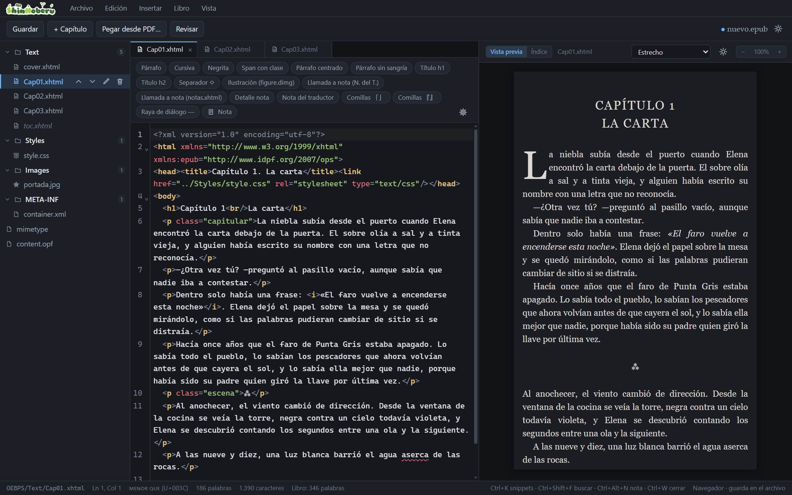
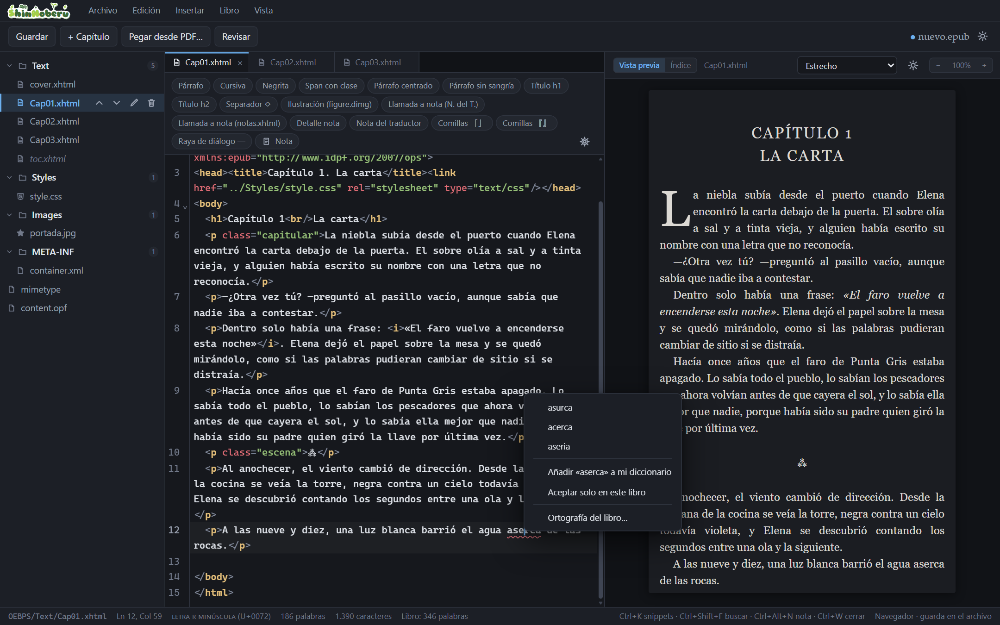
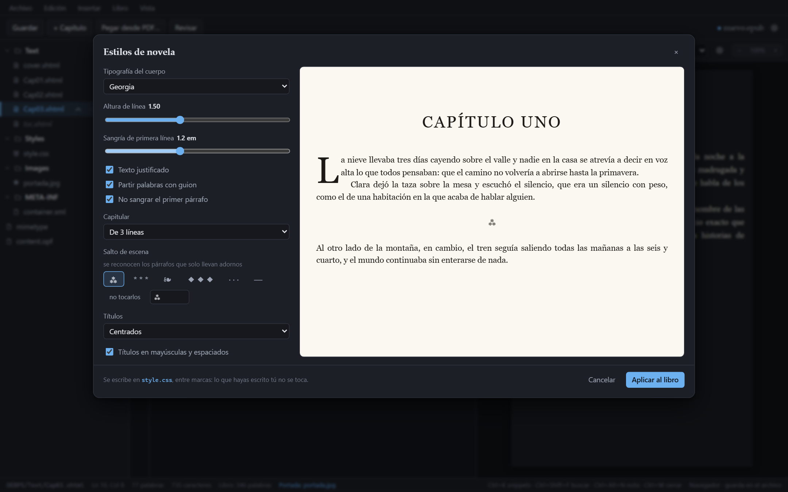
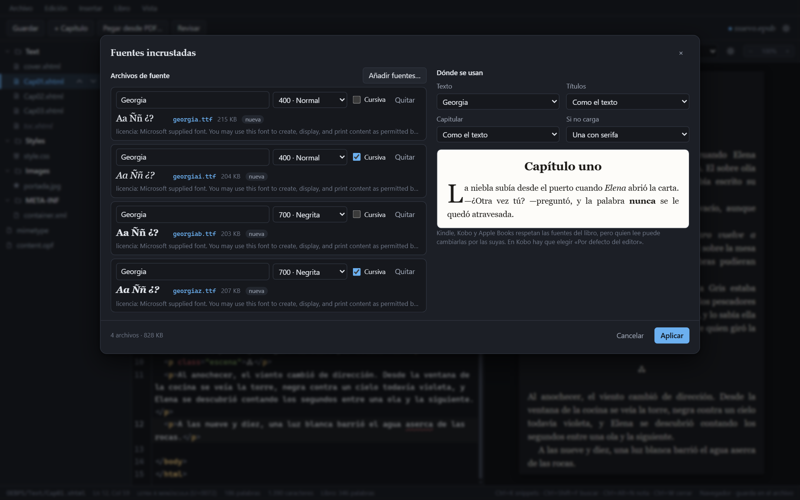
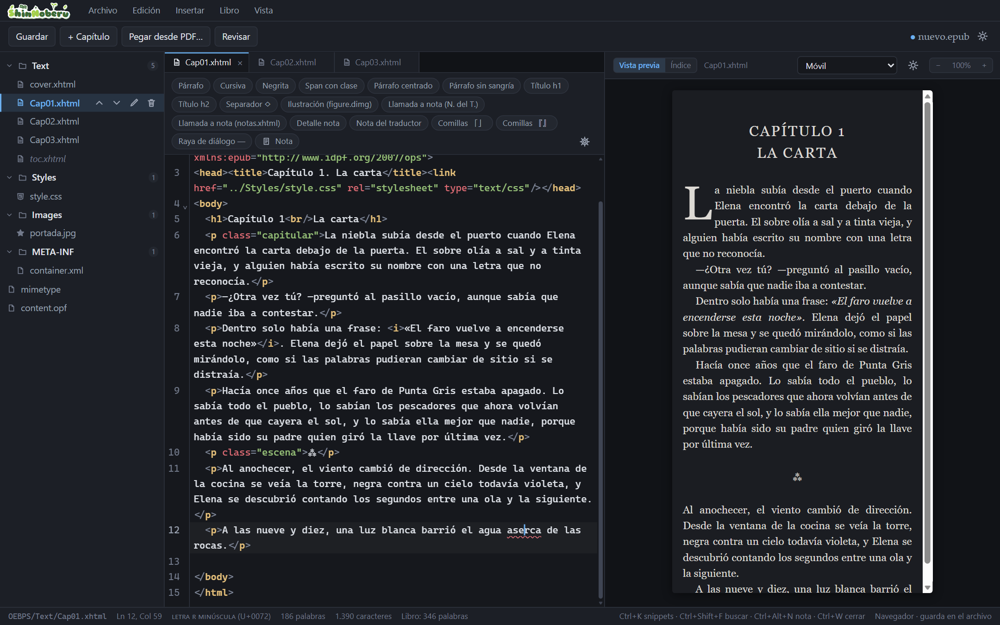
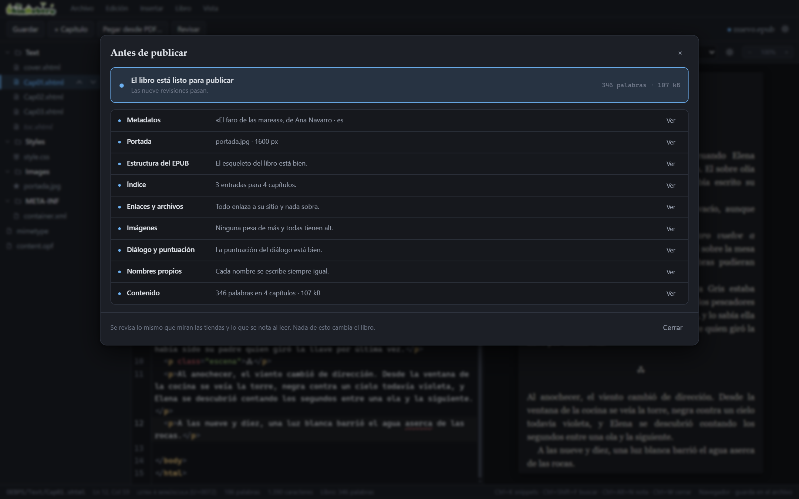
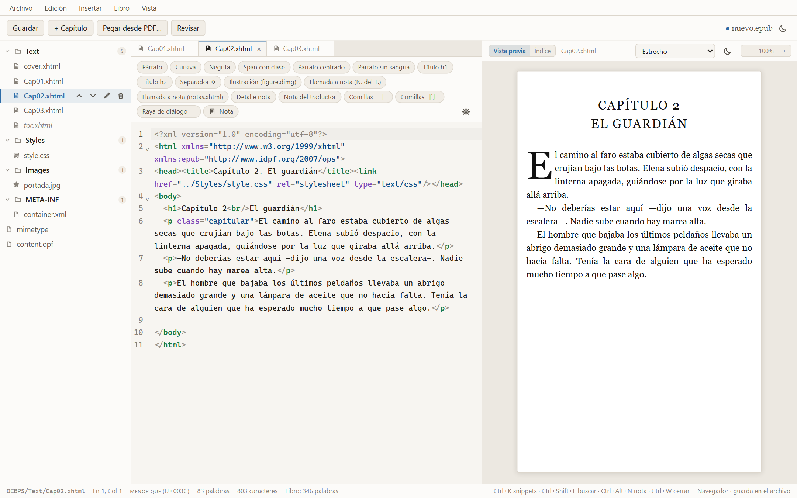

<h1 align="center">
  
</h1>

**ShinNoberu** es un editor de EPUB 3 de escritorio pensado para **maquetar novelas**, en especial
novelas ligeras traducidas al español. Trabaja directamente sobre el XHTML del
libro, como Sigil, pero añade lo que hace falta para dejar una novela lista
para publicar: estilos de novela, notas del traductor, ortografía en español,
fuentes incrustadas y una revisión final antes de subir el libro a la tienda.

## Por qué existe

Me encantan las novelas, sobre todo las novelas ligeras. Pero muchas de las que
quiero leer solo existen en PDF o repartidas por páginas web, y ninguna de las
dos cosas se lee bien en un lector de tinta electrónica: el PDF no se adapta a la
pantalla y la web no se lleva en el bolsillo.

Quería tenerlas en mi ebook como un libro de verdad, con su portada, su índice,
sus notas y sus capítulos bien maquetados. Hacerlo a mano era lento y dejaba
errores por todas partes, así que construí la herramienta que me faltaba. Esa es
ShinNoberu: un taller para que esas historias lleguen al lector tan bien
presentadas como merecen.

> [!NOTE]
> **Este proyecto está hecho con *vibe coding*.** El código lo escribió una IA
> ([Claude Code](https://claude.com/claude-code)) a partir de conversaciones en
> las que se pedía cada función, se probaba y se corregía lo que no gustaba. Tiene
> pruebas automáticas y se prueba en un navegador real, pero nadie lo ha revisado
> línea a línea como se revisa un proyecto escrito a mano. Guarda copia de tus
> libros antes de editarlos y comprueba el EPUB final antes de publicarlo.



Hecho con [Tauri 2](https://tauri.app), React, TypeScript y
[CodeMirror 6](https://codemirror.net). Toda la interfaz está en español.

## Qué hace

### Escribir y editar

- **Editor de XHTML** con resaltado, cierre de etiquetas, búsqueda y pestañas.
  Al lado, la **vista previa** del capítulo, que navega entre capítulos.
- **Snippets** con atajos de teclado para lo que se repite: párrafos, títulos,
  ilustraciones, comillas y raya de diálogo. Los de notas se numeran solos: la
  llamada coge el número siguiente, y el texto de la nota coge el de la primera
  llamada que aún no tiene nota y enlaza de vuelta a su capítulo.
- **Pegar desde PDF o Word**: limpia los cortes de línea, guiones y espacios
  de un texto copiado y lo convierte en párrafos. También importa un `.docx`
  entero.
- **Buscar y reemplazar en todo el libro**, con expresiones regulares, la
  opción de ignorar las etiquetas y búsquedas guardadas.
- **Carácter bajo el cursor**: la barra de estado dice qué hay delante del
  cursor y su código (`raya (U+2014)`, `semirraya (U+2013)`). Así se cazan los
  espacios duros y guiones blandos que cuela un PDF. **Insertar carácter**
  ofrece los que se usan al maquetar: — « » 「」 『』 ◇ y el espacio duro.
- **Árbol por carpetas** (`Text`, `Styles`, `Images`, `Fonts`), con menú
  contextual para duplicar, renombrar, eliminar, partir o usar una imagen
  como portada. Puedes soltar imágenes, CSS o fuentes sobre la ventana para
  añadirlos, o un `.epub` para abrirlo.
- **Pestañas** con el historial de deshacer de cada archivo, **archivos
  recientes** y recuento de palabras del capítulo y del libro.
- **Paneles redimensionables**, tema claro y oscuro, y tipografías y colores
  a tu gusto en las preferencias.

### Ortografía en español



- Subraya las palabras dudosas mientras escribes, con el diccionario español
  de LibreOffice. Con clic derecho salen sugerencias, y puedes añadir la
  palabra a tu diccionario (para todos tus libros) o solo al de este libro.
- No marca los nombres de los personajes, que saca del propio libro, ni los
  superlativos y diminutivos de palabras que existen («cansadísimo»,
  «perrito»).
- **Ortografía del libro** reúne todas las palabras dudosas, cuántas veces
  sale cada una y dónde, y permite corregirlas en todo el libro de una vez.

### Maquetar



- **Estilos de novela**: tipografía, interlineado, sangría, texto
  justificado con guiones, capitular de 2 a 4 líneas, ornamento del salto de
  escena y estilo de los títulos, con vista previa. Los escribe en un bloque
  aparte de la hoja de estilos, sin tocar lo que hayas escrito tú.
- **Plantillas de maquetación**: guarda el aspecto de un libro y aplícalo al
  siguiente de la serie.
- **Fuentes incrustadas**: añades los archivos de la fuente y el editor lee su
  familia, su grosor, si es cursiva y **qué permite su licencia**. Eliges qué
  fuente va en el texto, en los títulos y en la capitular, y te avisa si a la
  familia le falta la cursiva o la negrita.



- **Pantallas de lectores**: la vista previa con el tamaño de un Kindle, un
  Kobo, un Onyx Boox, un móvil o una tablet.



### Estructura del libro

- **Reordenar capítulos arrastrándolos** en la lista de archivos; el índice
  los sigue solo.
- **Renombrar en serie** (`Cap01.xhtml`, `Cap02.xhtml`…) arreglando todos los
  enlaces.
- **Partir y fusionar capítulos**, duplicar y renombrar archivos.
- **Índice**: lo regenera a partir de los títulos (`nav` y, si quieres,
  `toc.ncx`). También puede añadir una **página de índice visible** que se
  mantiene al día sola.
- **Notas**: notas al pie con ida y vuelta, y paso de todas a una página de
  notas al final del libro (y vuelta atrás).
- **Preliminares y cortesía**: portadilla, créditos, dedicatoria y las páginas
  de cortesía habituales.
- **Metadatos y portada**: título, autor, serie, ISBN, materias y portada,
  con los roles y propiedades que piden las tiendas.
- **Optimizar imágenes**: reduce el tamaño de las ilustraciones pesadas.

### Revisar antes de publicar



- **Antes de publicar** junta todas las revisiones en un semáforo: metadatos,
  portada, estructura, índice, enlaces, imágenes, fuentes, diálogo, nombres y
  contenido. Cada punto abre el panel que lo arregla.
- **Revisar las notas**: que cada llamada lleve a su nota y cada nota vuelva
  a su llamada, con el mismo número. Avisa de vueltas que llevan a otra
  llamada, notas a las que no llama nadie, y números saltados, repetidos o
  fuera de orden, aunque el EPUB sea válido.
- **Revisar el diálogo**: rayas mal puestas, incisos sin cerrar, comillas y
  signos de apertura que faltan.
- **Nombres del libro**: detecta las variantes de un mismo nombre
  («Kazuto», «Kasuto»), que son fáciles de cometer y difíciles de ver.
- **Enlaces y archivos sueltos**: enlaces rotos y archivos que nadie usa.
- **Informe del libro**: palabras, tiempo de lectura por capítulo, frases
  demasiado largas y palabras que se repiten.
- **Limpiar documento**: comillas rectas a latinas, puntos suspensivos,
  espacios dobles y párrafos vacíos.

### Sin perder trabajo

- **Guardado automático** del borrador: si la app se cierra, al abrirla
  ofrece recuperarlo.
- **Puntos de control**: instantáneas del libro para volver atrás y
  comparar. Los cambios grandes crean uno solo y ofrecen «Deshacer».



## Atajos

| Atajo | Acción |
|---|---|
| Ctrl+K | Todos los comandos |
| Ctrl+P | Ir a un archivo por su nombre |
| Ctrl+Shift+F | Buscar y reemplazar en todo el libro |
| Ctrl+I / Ctrl+B | `<em>` / `<strong>` |
| Ctrl+E | Párrafo centrado |
| Ctrl+Shift+P | Párrafo sin sangría |
| Alt+1 / Alt+2 | `<h1>` / `<h2>` |
| Ctrl+Shift+- | Raya de diálogo |
| Ctrl+Shift+9 / Ctrl+Shift+0 | Comillas 「」 / 『』 |
| Ctrl+Alt+N | Nota al pie con el siguiente número libre |
| Ctrl+Shift+V | Pegar sin limpiar |
| Ctrl+S / Ctrl+Shift+S / Ctrl+O | Guardar / Guardar como / Abrir |
| Ctrl+W | Cerrar la pestaña |
| Ctrl+, | Preferencias |

Los atajos de los snippets se cambian en **Insertar → Editar snippets…**,
pulsando la combinación que quieras. En el texto de un snippet, `|` marca
dónde queda el cursor.

## Instalar

Por ahora no hay instaladores publicados: hay que compilarlo.

### Requisitos

- [Node.js](https://nodejs.org) 22 o superior.
- [Rust](https://www.rust-lang.org/tools/install), para la app de escritorio.
- En Windows, WebView2 (viene con Windows 10 y 11) y las herramientas de
  compilación de C++ de Visual Studio. El resto de sistemas, en los
  [requisitos de Tauri](https://tauri.app/start/prerequisites/).

### Compilar

```bash
git clone <url-del-repositorio>
cd epub-editor
npm install
npm run tauri build
```

El ejecutable queda en `src-tauri/target/release/`, y los instaladores (NSIS
y MSI en Windows) en `src-tauri/target/release/bundle/`.

## Desarrollo

| Qué | Comando |
|---|---|
| App de escritorio en desarrollo | `npm run tauri dev` |
| Solo la interfaz, en el navegador | `npm run dev` → http://localhost:5173 |
| Comprobar tipos | `npx tsc -b` |
| Pruebas (Vitest) | `npm test` |
| Lint | `npm run lint` |
| Prueba de humo en un navegador real | `npm run prueba:navegador` |

En el navegador la app funciona igual; cambia cómo se guarda. En Edge y
Chrome, «Guardar» escribe encima del `.epub` que abriste: pide permiso la
primera vez y después Ctrl+S va directo al archivo. Firefox y Safari no tienen
esa API, así que cada guardado descarga una copia. La barra de estado indica
en cuál de los dos casos estás.

### Cómo está organizado

```
src/
  lib/          la lógica del libro, sin React, cada módulo con sus pruebas
  components/   diálogos y paneles
  App.tsx       el estado del libro y la unión de todo
  dict/es/      diccionario español (Hunspell)
scripts/
  navegador/    arnés para probar la app en Edge con clics y teclas reales
src-tauri/      la parte de escritorio (Rust)
```

El libro se abre en memoria con [JSZip](https://stuk.github.io/jszip/) y se
modifica con expresiones regulares sobre el texto, no reserializando el
XHTML: así se conservan la sangría, las comillas y el formato del original.
Lo que añade el editor (estilos de novela, fuentes, la página de índice) va
marcado, para no tocar nunca lo que escribiste a mano.

Las convenciones para contribuir están en [CLAUDE.md](CLAUDE.md).

## Licencias

El diccionario español es el de LibreOffice (RLA-ES), con triple licencia
GPL-3.0, LGPL-3.0 o MPL-1.1; el texto completo está en
[src/dict/es/LICENSE](src/dict/es/LICENSE). El proyecto en sí todavía no tiene
licencia publicada.
